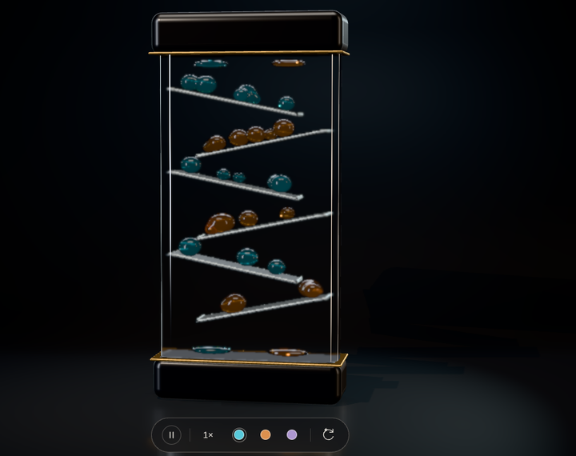
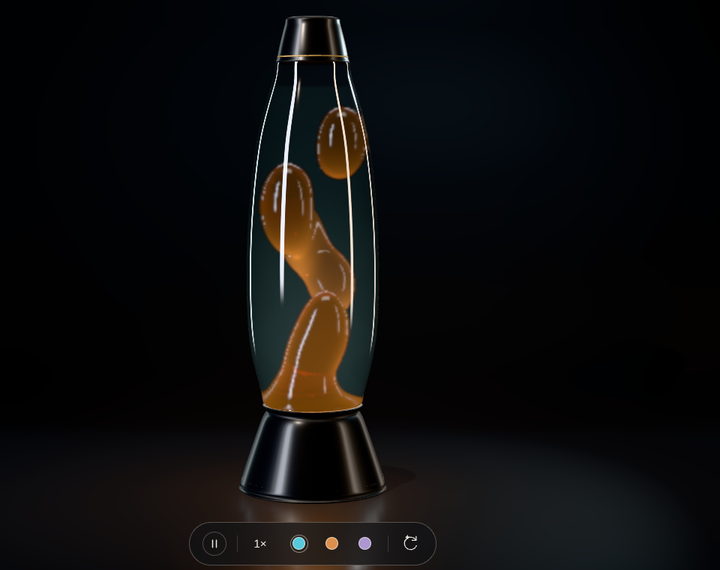
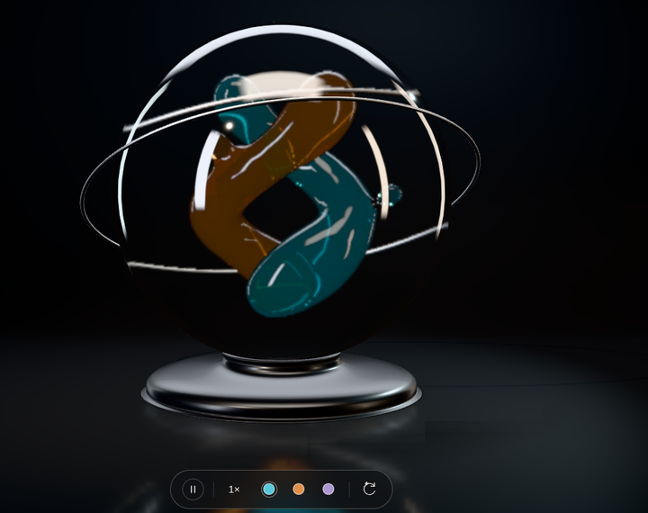
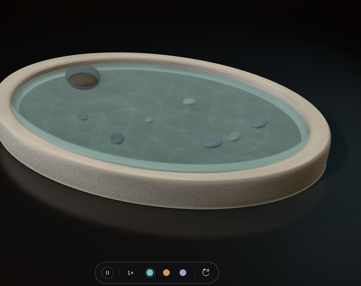
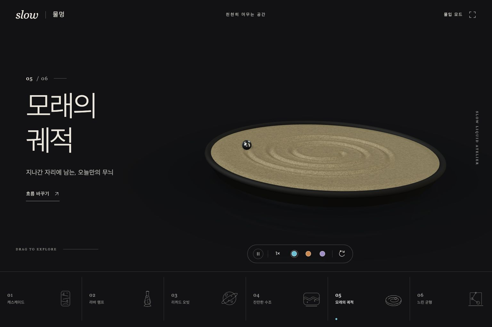
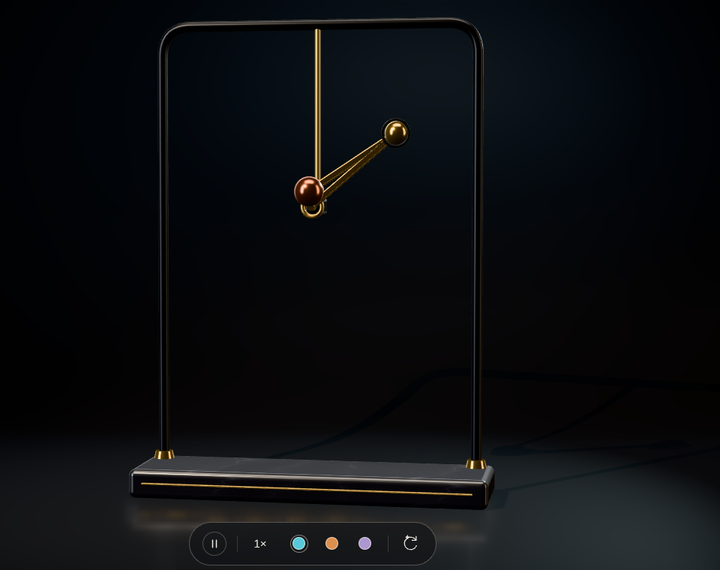

# slow · 물멍

조용한 스튜디오에서 액체, 물결, 모래, 진자를 바라보는 실시간 3D 아틀리에.

## 미리보기

새 렌더러(스튜디오 조명·레이마칭 액체)로 찍은 실제 WebGL 화면이야.

| 01 · 오일 캐스케이드 | 02 · 라바 램프 | 03 · 리퀴드 오빗 |
| :---: | :---: | :---: |
|  |  |  |

| 04 · 잔잔한 수조 | 05 · 모래의 궤적 | 06 · 느린 균형 |
| :---: | :---: | :---: |
|  |  |  |

[전체 화면 스크린샷](docs/screenshots/overview.png) · [모바일](docs/screenshots/mobile.png)

`docs/gifs/`의 GIF는 이전 렌더러로 찍은 기록이라 지금 화면과 달라. 실시간 1× 재촬영은 실제 GPU에서 다시 해야 해.

## 실행

외부 API, 설치할 패키지, 빌드 과정이 필요하지 않아. 저장소 폴더에서 정적 서버를 실행해.

```sh
python3 -m http.server 5173 --bind 127.0.0.1 --directory dist
```

브라우저에서 [http://localhost:5173](http://localhost:5173)을 열면 돼.

## 여섯 가지 컬렉션

| 컬렉션 | 움직임 |
| --- | --- |
| 오일 캐스케이드 | 중력과 경사면 충돌을 계산하는 점성 방울. 용기를 뒤집으면 중력 방향도 연속해서 바뀜 |
| 라바 램프 | 덩어리별 온도와 부력을 유지하는 대류. 서로 다른 속도로 뜨고 가라앉음 |
| 리퀴드 오빗 | 합쳐지는 두 액체의 흐름. 천천히 변하는 반지름과 기울기로 짧은 고정 루프를 피함 |
| 잔잔한 수조 | 높이와 속도를 적분하는 물결. 무작위 위치의 작은 파문이 만나고 벽에서 반사됨 |
| 모래의 궤적 | 구슬이 실제 높이장에 홈과 둔덕을 남김. 기존 자국을 유지하면서 다음 곡선을 그림 |
| 느린 균형 | 고정 시간 간격으로 적분하는 이중 진자. 이전 상태에서 다음 움직임을 계산함 |

리퀴드 오빗과 라바는 표면을 실시간으로 재구성해. 재생 영상을 되감는 방식이 아니야. 모래의 초기 나선도 사진이나 텍스처 대신 실제 표면 높이로 새겨져 있어.

## 조작

- 드래그: 시점 회전. 스크롤: 확대·축소. 더블 클릭: 처음 시점.
- `Space`: 재생·정지. `R`: 현재 장면에 힘 주기. `H`: 몰입 모드. `Esc`: 몰입 모드 종료.
- `1`~`6`: 컬렉션 선택.
- 3D 화면에 키보드 초점을 두면 방향키로 회전하고 `+`/`-`로 확대·축소할 수 있어. `Home`으로 시점을 초기화해.
- 모바일에서는 아래 컬렉션을 좌우로 밀어서 나머지 장면을 고를 수 있어.

`prefers-reduced-motion` 설정에서는 처음에 정지 상태로 열려. 탭이 보이지 않을 때는 계산을 쉬고, 일시정지 중에는 화면이 바뀔 때만 다시 그려.

## 구현과 검증

- Three.js를 저장소에 포함해서 런타임 CDN에 의존하지 않아.
- **스튜디오**: 바닥이 벽으로 휘어 올라가는 촬영용 스윕 위에 조형물을 올려. 소프트박스로 만든 HDR 환경맵이 유리·물·금속에 선명한 띠 반사를 만들고, 그림자를 드리우는 키 스팟과 벽을 비추는 워시, 림 라이트를 써. 바닥은 흐린 평면 반사를 프레넬로 섞어. Bloom이나 렌즈 플레어는 없어.
- **액체(캐스케이드·라바·오빗)**: 메쉬 대신 레이마칭한 메타볼(smooth-min SDF)로 그려. 표면에서 굴절해 들어가 반대편 출구까지 다시 마칭해서 실제 두께를 구하고, 그 두께로 Beer–Lambert 흡수를 계산해. 얇은 가장자리는 맑고 두꺼운 곳은 색이 짙어지며, 뒤의 장면이 굴절되어 보여. 두 액체가 겹치면 한 액체를 통해 다른 액체가 보여. 라바 왁스는 아래 히터 쪽이 빛나고, 램프 안의 액체도 은은하게 발광해.
- **유리**: 액체가 담긴 장면 버퍼를 따로 렌더해서 유리 껍데기가 그 안의 액체를 굴절해 보여 줘(분산 포함).
- **수조**: 물결 높이장을 텍스처로 올려 바닥에 코스틱을 계산해(물마루가 빛을 모으는 곳이 밝아짐). 물은 굴절·흡수로 돌 바닥과 조약돌을 보여 줘.
- **모래**: 낮은 각도의 레이킹 라이트가 홈마다 그림자를 만들어.
- 카메라는 실제 UI 요소의 위치를 재서 남는 공간에 조형물을 맞추고(view offset), 조형물은 바닥 위 턴테이블처럼 돌아.
- 질감은 이미지 없이 절차적 노이즈로 만들어.
- Node.js 22 이상에서 추가 패키지 설치 없이 검사할 수 있어.

```sh
npm run check
npm test
```

헤드리스 Chrome(SwiftShader WebGL)으로 데스크톱 1536×1024와 모바일 390×844 화면을 확인했어. 테스트는 장시간 좌표 안정성, 물결 법선, 모래 자국 유지, 일시정지, 연속 충격, 진자의 프레임 속도 독립성을 다뤄.

수치 계산과 재질은 감각적인 화면을 위한 근사 모델이야. 정밀한 전산유체역학이나 광선 추적 결과는 아니야. 레이마칭 액체와 여러 장면 버퍼 때문에 이전보다 GPU 부하가 커. 실제 GPU·모바일에서의 프레임 속도는 아직 확인하지 않았어. 6초 동안 30fps 아래면 해상도를 줄여.

## 참고 자료와 라이선스

구현에 참고한 원본과 적용 범위는 [리서치 기록](docs/REFERENCES.md), 화면 검증은 [디자인 QA](design-qa.md)에 적었어. [디자인 참고 이미지](docs/design-reference.png)는 이미지 생성으로 만든 방향성 자료이며 실제 실행 화면과 구분돼.

포함된 Three.js와 addon은 [MIT 고지](dist/vendor/THREE-LICENSE)를 유지해. 외부 프로젝트의 코드나 이미지를 추가로 복사하지 않았어. 이 저장소 전체에 대한 별도 라이선스는 아직 지정하지 않았어.
