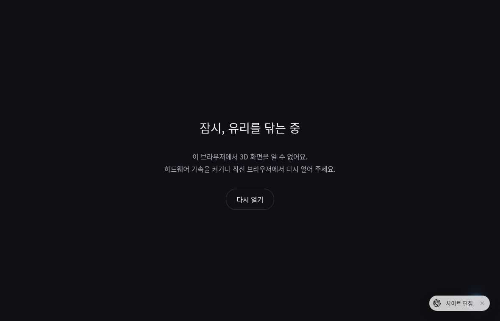

# Slow Liquid Atelier

Four procedural Three.js liquid-and-light toys.

## Run

Serve `dist/` with a static HTTP server, for example `python3 -m http.server 8000 --directory dist`, then open http://localhost:8000. No build or API key is required.

## Limitations

This export matches the published v1. The later unpublished visual-rework candidate is not included. Actual WebGL appearance, real-device interaction and mobile performance were not verified. This is a stylized visual simulation, not a physical fluid solver.

## Third-party code

Vendored Three.js files retain their MIT notice in `dist/vendor/THREE-LICENSE`. No project-wide license is assigned by this export.

## 미리보기 환경 제한

캡처 환경의 WebGL 비활성화로 표시된 실제 안내 화면. 정상 3D 렌더 결과를 보여주는 이미지가 아닙니다.

